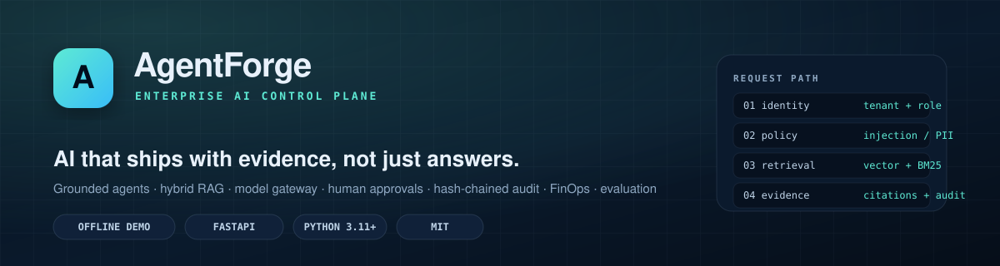
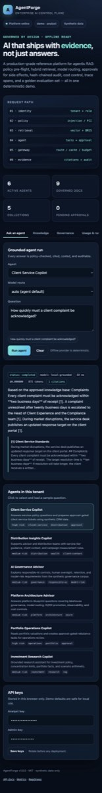
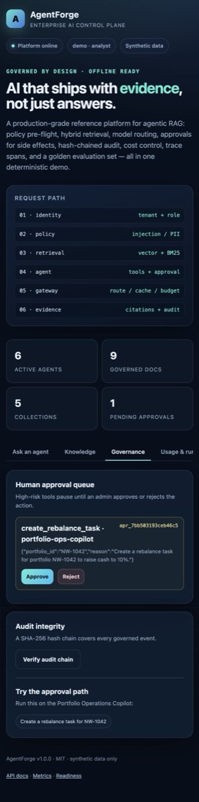
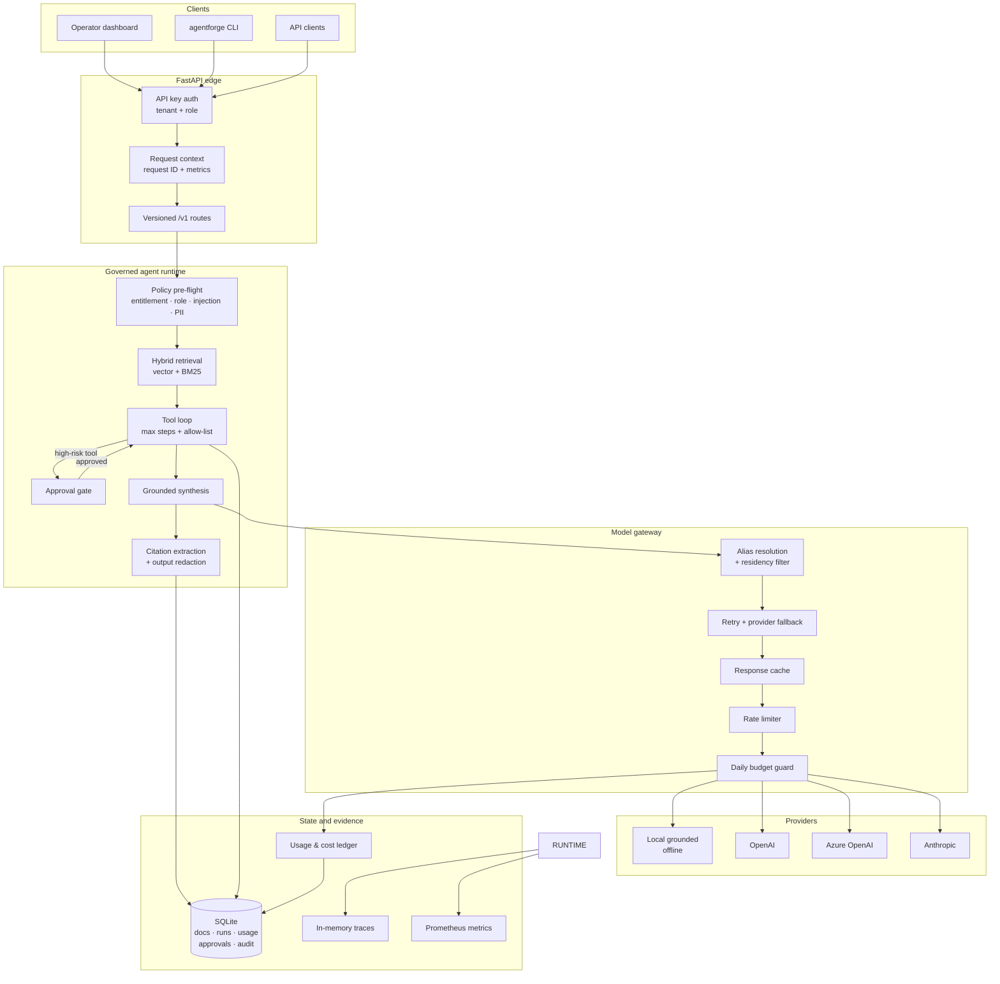

<div align="center">
  
</div>

# AgentForge — Enterprise AI Control Plane

**Grounded agents, hybrid RAG, model routing, human approvals, tamper-evident audit, FinOps, and evaluation — in one runnable reference platform.**

[](https://github.com/MrKyaw/AgentForge-Enterprise-AI-Platform/actions/workflows/ci.yml)
[](docs/TEST_RESULTS.md)
[](docs/TEST_RESULTS.md)
[](docs/EVALUATION_RESULTS.md)
[](pyproject.toml)
[](pyproject.toml)
[](LICENSE)

> **No API keys. No network. Deterministic.** The complete demo runs offline with a grounded local provider, so reviewers can inspect every control-plane behaviour in under two minutes.

---

## Why this exists

Most AI agent demos stop at the happy path: one prompt, one model call, one answer. Enterprise adoption fails somewhere else — entitlement checks, data classification, prompt injection, unreviewed side effects, cost overruns, and evidence that satisfies an auditor.

AgentForge is a **control plane around those failure modes**. It combines the capabilities that are usually scattered across separate prototypes:

| Concern | What AgentForge implements |
|---|---|
| Access control | Tenant + role principals, agent entitlements, per-role data clearance |
| Grounding | Hybrid dense + BM25 retrieval with citations and explicit refusal |
| Model access | Provider-neutral gateway with aliases, fallback, retry, cache, residency |
| Side effects | Human approval pause/resume for high-risk tools |
| Safety | Prompt-injection scoring, PII redaction, output redaction |
| Evidence | Append-only SHA-256 hash-chained audit log with verification |
| Operations | Request traces, Prometheus metrics, health/readiness probes |
| FinOps | Token and cost ledger, per-tenant daily budgets, usage summaries |
| Quality | Golden evaluation set with pass rate, citation and refusal accuracy |

It is a **reference implementation**, not a deployed bank platform. The data is synthetic, the local provider is deterministic and extractive, and the production extension points are documented honestly below.

---

## Screenshots

| Grounded answer with citations | Approval queue and audit integrity |
|---|---|
|  |  |

---

## Quickstart

### Local (recommended)

```bash
git clone https://github.com/MrKyaw/AgentForge-Enterprise-AI-Platform.git
cd AgentForge-Enterprise-AI-Platform

python3 -m venv .venv
source .venv/bin/activate
pip install -e ".[dev]"

agentforge demo      # five governed agent runs in the terminal
agentforge serve     # dashboard at http://localhost:8000
```

The first command seeds a synthetic knowledge base (9 documents, 58 chunks, 5 collections) into SQLite, runs representative questions through the full governed path, and verifies the audit chain.

### Docker

```bash
docker compose up --build
# http://localhost:8000
```

### Make targets

```bash
make dev      # editable install with dev tools
make test     # 269 tests with coverage gate
make lint     # ruff check + format check
make eval     # golden evaluation set, fail below 100%
make serve    # API + dashboard
make docker   # container build and run
```

---

## What the demo shows

```text
$ agentforge ask "How quickly must a client complaint be acknowledged?"

Based on the approved knowledge base: Complaints Every client complaint must be
acknowledged within **two business days** of receipt [1]. A complaint unresolved
after twenty business days is escalated to the Head of Client Experience and the
Compliance team [1]. During market disruptions, the service desk publishes an
updated response target on the client portal [1].

status=completed model=local-grounded tokens=875 cost=$0.00 latency=2ms

Citations:
  [1] Client Service Standards — Every client complaint must be acknowledged ...
```

```text
$ agentforge eval --fail-under 1.0

pass=20/20 (100.0%)  citations=100.0%  refusals=100.0%  p95=3ms  cost=$0.000000
```

```text
$ agentforge verify-audit
OK  Audit chain verified. (10 events)
```

### Trigger the approval path

The Portfolio Operations Copilot proposes a side-effecting task, then pauses:

```bash
curl -s http://localhost:8000/v1/agents/portfolio-ops-copilot/run \
  -H "X-API-Key: demo-analyst-key" \
  -H "Content-Type: application/json" \
  -d '{"input":"Create a rebalance task for portfolio NW-1042 to raise cash to 10%."}'
```

The response has `status: "pending_approval"` and an `approval_id`. An admin can inspect, approve, or reject it:

```bash
curl -s http://localhost:8000/v1/approvals \
  -H "X-API-Key: demo-admin-key"

curl -s -X POST http://localhost:8000/v1/approvals/<APPROVAL_ID>/approve \
  -H "X-API-Key: demo-admin-key"
```

No tool with side effects executes before that decision. Approval, rejection, execution success, and execution failure are each written to the audit chain.

---

## Architecture



### Request lifecycle

1. **Authenticate** — API key maps to `tenant`, `role`, and a non-secret `key_id`. Keys are never accepted from query strings.
2. **Authorize** — tenant entitlement, role policy, lifecycle state, requested model, and input length are checked before any model call.
3. **Screen** — heuristic prompt-injection score blocks high-risk input; PII and secrets are redacted before the prompt is built.
4. **Retrieve** — hybrid vector + BM25 search across the agent's collections, limited by role clearance and the agent's classification ceiling.
5. **Reason** — the gateway resolves a model alias, applies residency constraints, checks the budget, and calls a provider with retry and fallback.
6. **Act** — only tools on the agent allow-list can run. Tools with side effects pause the run and create an approval request.
7. **Ground** — citations are mapped back to retrieved chunks; unsupported markers are flagged; output PII is redacted.
8. **Record** — run, usage, trace, metrics, and a hash-chained audit event are persisted.

---

## Capabilities

### Governed agent runtime

Six reference agents ship with explicit purpose, owner, version, model tier, data scope, tool allow-list, entitlements, risk level, and step limit. Agents are versioned in a registry, not hard-coded into routes.

| Agent | Purpose | Model tier | Risk | Side effects |
|---|---|---|---|---|
| `research-copilot` | Investment policy and portfolio questions | balanced | medium | No |
| `client-service-copilot` | Service standards and client context | fast | high | Approval required |
| `governance-advisor` | Responsible AI and model risk | balanced | medium | No |
| `platform-architect` | Lakehouse, routing, CI/CD, FinOps | reasoning | medium | No |
| `distribution-copilot` | Service tiers and distribution guidance | fast | medium | No |
| `portfolio-ops-copilot` | Valuations and rebalance tasks | balanced | high | Approval required |

### Hybrid retrieval (RAG)

- Heading-aware markdown chunking with overlap and token estimates.
- Deterministic hashing embeddings for offline, reproducible retrieval.
- BM25 keyword scoring fused with vector similarity.
- Collection filters, metadata filters, classification ceilings, and deduplication.
- SHA-256 content hashes make ingestion idempotent.
- Chunk-level citations with scores and snippets returned to the caller.

### Model gateway

- Provider-neutral interface: local, OpenAI, Azure OpenAI, Anthropic.
- Logical aliases (`fast`, `balanced`, `reasoning`, `private`, `economy`) resolve to ordered fallback chains.
- Residency filtering (`local`, `canada`, `global`) keeps restricted data in approved regions.
- Exponential-backoff retries for retryable provider errors.
- Response caching keyed by model, tenant, messages, temperature, and token limit.
- Per-tenant sliding-window rate limiting and daily budget enforcement.
- Every call writes prompt/completion tokens, cost, latency, and cache status to the usage ledger.

### Guardrails

- Prompt-injection scoring across instruction override, prompt exfiltration, jailbreak phrases, guardrail bypass, data exfiltration, and role override.
- Configurable block threshold, with lower-confidence signals surfaced as warnings.
- Regex + Luhn-validated redaction for email, phone, SIN, credit card, IBAN, and secret-like tokens.
- Input and output redaction counts returned with the run.
- Data classification: `public` → `internal` → `confidential` → `restricted`, intersected with role clearance.

### Human approvals

Tools marked `requires_approval` never execute inline. The runtime persists an approval request, returns `pending_approval`, and waits. An admin decision resumes execution exactly once and records the outcome. Rejection performs no side effect.

### Tamper-evident audit

Every governed event includes the previous event's hash; verification recomputes the full chain and reports the first broken link. Events cover authentication-sensitive actions, ingestion, run start/completion/failure, blocked tools, approval decisions, and executions. JSONL export supports evidence retention.

### Observability

- Request IDs propagate to responses and structured logs.
- Trace spans for retrieval, each model call, and each tool invocation.
- Prometheus metrics for HTTP, runs, latency, tokens, cost, cache, rate limits, tool calls, approvals, and citations.
- `/healthz` for liveness, `/readyz` for dependency readiness, `/metrics` for scraping.

### FinOps

- Per-model input/output token pricing in an explicit, replaceable catalogue.
- Per-tenant daily budget checked before the call.
- Usage summaries by model and agent over a configurable window.
- Cache hits recorded at zero marginal cost so savings are measurable.

### Evaluation

A 20-case golden set covers grounding, policy, service levels, governance, platform architecture, tool use, and refusal. The harness checks keywords, citation count, refusal behaviour, run status, latency, and cost, then emits Markdown and JSON reports.

**Result: 20/20 passed, 100% citation accuracy, 100% refusal accuracy.** See [docs/EVALUATION_RESULTS.md](docs/EVALUATION_RESULTS.md).

---

## API

Interactive OpenAPI docs are available at `/docs` when the server is running.

| Method | Path | Role | Purpose |
|---|---|---|---|
| `GET` | `/v1/agents` | any | List agents visible to the tenant |
| `GET` | `/v1/agents/{name}` | any | Get an agent definition |
| `GET` | `/v1/agents/{name}/versions` | any | List registered versions |
| `POST` | `/v1/agents/{name}/run` | analyst, admin | Run a governed agent |
| `GET` | `/v1/runs` | any | List recent tenant runs |
| `GET` | `/v1/runs/{id}` | any | Get a run result |
| `GET` | `/v1/runs/{id}/trace` | any | Get trace spans |
| `GET` | `/v1/usage/summary` | any | Token, cost, and cache summary |
| `GET` | `/v1/knowledge/collections` | any | Collection statistics |
| `GET` | `/v1/knowledge/documents` | any | List visible documents |
| `POST` | `/v1/knowledge/documents` | admin | Ingest a document |
| `DELETE` | `/v1/knowledge/documents/{id}` | admin | Delete a document |
| `POST` | `/v1/knowledge/search` | any | Hybrid search |
| `GET` | `/v1/approvals` | any | List approvals for the tenant |
| `POST` | `/v1/approvals/{id}/approve` | admin | Approve and execute |
| `POST` | `/v1/approvals/{id}/reject` | admin | Reject without side effects |
| `GET` | `/v1/audit` | admin | Read audit events |
| `GET` | `/v1/audit/verify` | admin | Recompute the hash chain |
| `POST` | `/v1/evals/run` | admin | Run the golden set |
| `GET` | `/v1/models` | any | Model catalogue and availability |
| `GET` | `/v1/whoami` | any | Resolve the caller principal |
| `GET` | `/v1/version` | any | Version metadata |
| `GET` | `/healthz` | none | Liveness |
| `GET` | `/readyz` | none | Readiness |
| `GET` | `/metrics` | none | Prometheus metrics |

Errors use one envelope with a request ID:

```json
{
  "error": {
    "code": "policy_violation",
    "message": "Potential prompt injection detected; request blocked.",
    "details": {"score": 0.65, "signals": ["instruction_override"]}
  },
  "request_id": "req_..."
}
```

Full request and response examples: [docs/API.md](docs/API.md).

---

## Demo credentials

| Key | Tenant | Role | Use |
|---|---|---|---|
| `demo-analyst-key` | demo | analyst | Run agents, read knowledge |
| `demo-admin-key` | demo | admin | Ingest, approve, audit, evaluate |
| `research-analyst-key` | research | analyst | Cross-tenant entitlement demo |
| `viewer-key` | demo | viewer | Public-classification read-only |

> **These are local demo keys, embedded only so the offline dashboard works.** Replace `AGENTFORGE_API_KEYS` before exposing the service anywhere. The dashboard stores keys in browser storage; production deployments should use SSO/OIDC and short-lived tokens instead.

---

## Configuration

All settings are environment variables with safe local defaults. Copy `.env.example` to `.env` or export them.

| Variable | Default | Purpose |
|---|---|---|
| `AGENTFORGE_ENV` | `development` | Environment label |
| `AGENTFORGE_DB_PATH` | `var/agentforge.db` | SQLite path |
| `AGENTFORGE_DATA_DIR` | `data` | Corpus and evaluation data |
| `AGENTFORGE_SEED_ON_STARTUP` | `true` | Ingest demo corpus when empty |
| `AGENTFORGE_API_KEYS` | demo keys | `key:tenant:role` list |
| `AGENTFORGE_AUTH_ENABLED` | `true` | Toggle authentication |
| `AGENTFORGE_RATE_LIMIT_PER_MINUTE` | `120` | Tenant model-call rate |
| `AGENTFORGE_RATE_LIMIT_BURST` | `30` | Token-bucket burst |
| `AGENTFORGE_DAILY_BUDGET_USD` | `25.0` | Per-tenant daily budget |
| `AGENTFORGE_CACHE_TTL_SECONDS` | `300` | Completion cache TTL |
| `AGENTFORGE_INJECTION_THRESHOLD` | `0.7` | Block threshold |
| `AGENTFORGE_RETRIEVAL_TOP_K` | `4` | Chunks per collection |
| `AGENTFORGE_MAX_INPUT_CHARS` | `8000` | Input ceiling |
| `AGENTFORGE_REDACT_OUTPUT` | `true` | Redact PII in answers |
| `OPENAI_API_KEY` | unset | Enable OpenAI adapter |
| `ANTHROPIC_API_KEY` | unset | Enable Anthropic adapter |
| `AZURE_OPENAI_ENDPOINT` | unset | Enable Azure adapter |
| `AZURE_OPENAI_API_KEY` | unset | Azure credential |

If no provider keys are present, the gateway automatically stays on `local-grounded`. Adding a key changes the available provider set with no code changes.

---

## Testing and quality

```text
$ python -m pytest -q --cov=agentforge --cov-report=term

269 passed in 8.11s
TOTAL   3080 statements   65 missed   728 branches   59 partial   96%
```

- 269 tests across 27 modules, including a full end-to-end workflow.
- Every test uses an isolated SQLite database and a deterministic clock where relevant.
- Coverage gate: 85% (actual: 96% branch coverage).
- Lint/format gate: `ruff check` and `ruff format --check`.
- CI workflow: Python 3.11 and 3.12, lint, tests with coverage, golden evaluation, package build, Docker build.

See [docs/TEST_RESULTS.md](docs/TEST_RESULTS.md) for the module-level breakdown and [docs/TESTING.md](docs/TESTING.md) for the strategy.

---

## Project layout

```text
.
├── src/agentforge/
│   ├── agents/          # registry, governed runtime, tool implementations
│   ├── api/             # FastAPI app, routes, schemas, dashboard
│   ├── evals/           # golden-set harness and report rendering
│   ├── gateway/         # provider adapters, routing, pricing
│   ├── governance/      # pre-flight policy engine
│   ├── rag/             # chunking, embeddings, BM25, retrieval, ingestion
│   ├── audit.py         # hash-chained audit log
│   ├── approvals.py     # approval state machine
│   ├── auth.py          # tenant and role authentication
│   ├── bootstrap.py     # composition root and demo seeding
│   ├── cli.py           # demo, ask, eval, doctor, audit commands
│   ├── security.py      # PII redaction and injection scoring
│   ├── tracing.py       # trace spans
│   └── usage.py         # token and cost ledger
├── tests/               # 269 tests
├── data/corpus/         # 9 synthetic documents
├── data/demo/           # synthetic portfolios and clients
├── data/evals/          # 20-case golden set
├── docs/                # architecture, API, governance, operations, ADRs
├── assets/              # banner and dashboard screenshots
├── Dockerfile
├── docker-compose.yml
└── pyproject.toml
```

---

## Design decisions

**SQLite, not Postgres.** A single-file database keeps the demo reproducible and dependency-free. The data-access layer is isolated, so production can swap in Postgres or a lakehouse without changing domain logic.

**Deterministic local provider.** Reviewers should be able to run the whole platform without keys, network access, or spend. The local provider performs extractive synthesis over retrieved sources, which makes evaluation results reproducible. It is intentionally **not** a language model; hosted adapters are available when keys are configured.

**Hash chain, not a blockchain.** A SHA-256 chain gives cheap tamper evidence and portable JSONL export without inventing consensus infrastructure. It detects edits and deletions within the chain; it does not prevent a privileged operator from deleting the whole database, which is why export and external retention are documented.

**Heuristic guardrails, disclosed as such.** Injection scoring and regex redaction are fast pre-filters. They are transparent and testable, not a claim of complete defence. Production should add a model-based classifier and a DLP service.

**Approvals at the tool boundary.** Side effects are gated where they occur, not by prompt instruction. This is the only reliable place to enforce "do not execute without a human".

---

## Production readiness

**Implemented and tested**

- Versioned agents, tenant entitlements, role policy, data classification
- Hybrid RAG with citations, refusal, and idempotent ingestion
- Multi-provider gateway with fallback, retry, cache, rate limit, budget
- Approval pause/resume and rejection paths
- Hash-chained audit with verification and export
- Request tracing, Prometheus metrics, readiness checks
- Golden evaluation with CI gate
- Container build, health check, non-root runtime

**Deliberate extension points**

- **Identity**: replace static API keys with OIDC/SSO, scoped tokens, and workload identity.
- **Database**: move from SQLite to Postgres with row-level tenancy and migrations.
- **Vectors**: replace hashing embeddings with a managed vector index while keeping the retriever interface.
- **Secrets**: load provider credentials from a vault, not environment variables.
- **Guardrails**: add a model-based injection classifier and enterprise DLP.
- **Approvals**: add quorum, expiry, separation of duties, and notification integrations.
- **Audit**: stream events to immutable external storage and add retention policy automation.
- **Observability**: export OpenTelemetry spans to the enterprise backend.
- **Evaluation**: expand the golden set with adversarial, multilingual, and regression slices.
- **Scale**: move the in-process rate limiter and cache to Redis for multi-replica deployments.

These are explicit boundaries, not hidden gaps. The repository is designed so each can be replaced behind an existing interface.

---

## Documentation

| Document | Contents |
|---|---|
| [Architecture](docs/ARCHITECTURE.md) | Components, data flow, invariants, failure modes |
| [API guide](docs/API.md) | Authentication, endpoints, examples, errors |
| [Governance](docs/GOVERNANCE.md) | Policy model, approvals, audit, data handling |
| [Evaluation](docs/EVALUATION.md) | Golden set design, metrics, reproduction |
| [Evaluation results](docs/EVALUATION_RESULTS.md) | Actual 20-case run |
| [Operations](docs/OPERATIONS.md) | Runbooks, metrics, troubleshooting |
| [Deployment](docs/DEPLOYMENT.md) | Local, Docker, hardened production path |
| [Testing](docs/TESTING.md) | Test strategy and coverage |
| [Test results](docs/TEST_RESULTS.md) | Actual suite output |
| [ADRs](docs/adr/) | Key architecture decisions |
| [Security policy](SECURITY.md) | Reporting and threat model |
| [Contributing](CONTRIBUTING.md) | Development workflow |
| [Changelog](CHANGELOG.md) | Release history |
| [About](ABOUT.md) | Project intent and author |

---

## Synthetic data notice

All organizations, people, portfolios, policies, and numbers in this repository are fictional and were created for demonstration. **Lumen Ridge Asset Management** is not a real company. Nothing here is legal, compliance, investment, or security advice. Do not load confidential employer or client data into the demo.

## License

MIT — see [LICENSE](LICENSE).

## Author

**MrKyaw** — building governed AI systems that are testable, observable, and honest about their limits.

If this project is useful for your team, start with [ABOUT.md](ABOUT.md) for the design rationale and a guided review path.
