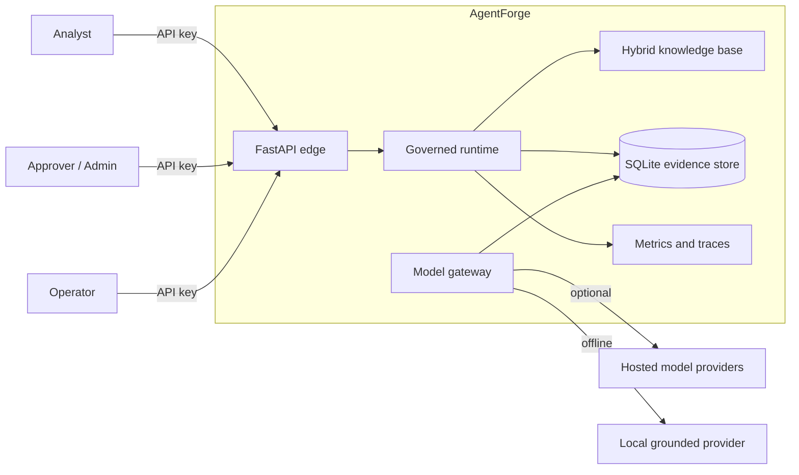
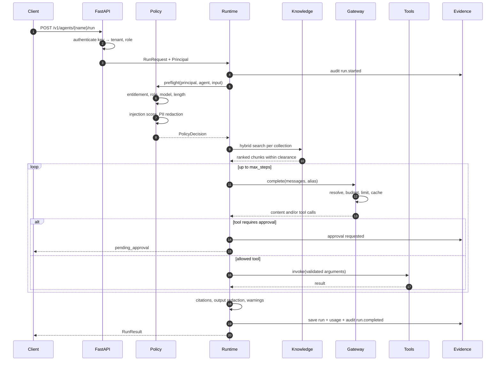
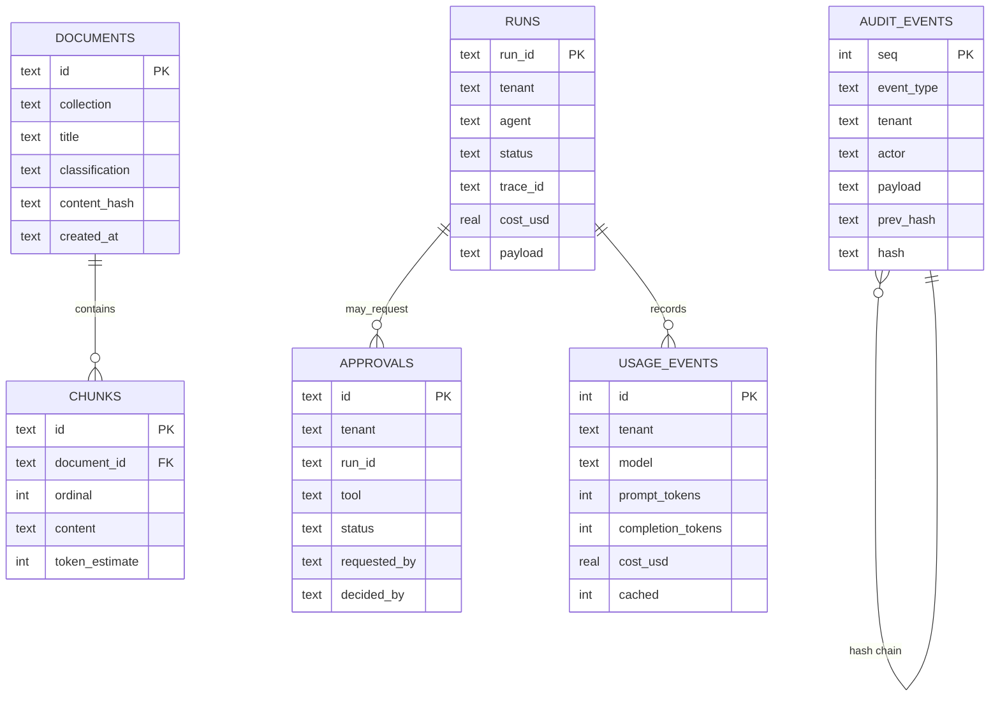
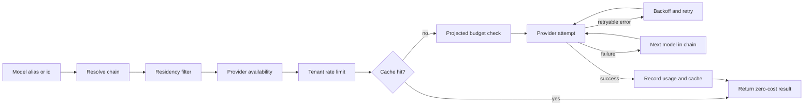

# Architecture

## 1. Purpose and scope

AgentForge is a reference implementation of a **governed enterprise AI control plane**. It answers one question:

> What has to be true around a model call before an enterprise can let an agent act?

The answer is expressed as code: identity, entitlement, classification, retrieval, routing, approval, evidence, cost control, and evaluation. The implementation is intentionally self-contained so the whole system can be run, read, and tested in one sitting.

**In scope:** the control plane, a deterministic demo corpus, six reference agents, HTTP and CLI surfaces, operational evidence.

**Out of scope:** a production identity provider, a managed vector database, a distributed queue, model fine-tuning, and vendor-specific infrastructure. Section 11 maps each boundary to an extension point.

## 2. System context

The system has one process and one SQLite file. That is a deliberate demo constraint: it removes infrastructure noise and makes the governance behaviour the centre of attention.

## 3. Component inventory

| Component | Module | Responsibility |
|---|---|---|
| Configuration | `config.py` | Environment parsing, API key principals, path resolution |
| Database | `db.py` | SQLite connection, schema, transactions, row access |
| Domain models | `models.py` | Pydantic contracts shared by API, runtime, and evals |
| Authentication | `auth.py` | API key → tenant/role principal |
| Policy | `governance/policy.py` | Pre-flight authorization and guardrail decision |
| Security | `security.py` | PII redaction, injection scoring, classification clearance |
| Knowledge base | `rag/ingest.py` | Ingestion, chunking, storage, search facade |
| Chunking | `rag/chunking.py` | Heading-aware chunk boundaries and overlap |
| Embeddings | `rag/embeddings.py` | Deterministic hashing vectors |
| BM25 | `rag/bm25.py` | Keyword index and scoring |
| Retrieval | `rag/retriever.py` | Hybrid score fusion, filters, dedupe |
| Store | `rag/store.py` | Document and chunk persistence |
| Agent registry | `agents/registry.py` | Versioned agent catalogue |
| Tools | `agents/tools.py` | Allow-listed tool definitions and handlers |
| Runtime | `agents/runtime.py` | Governed lifecycle and evidence |
| Gateway | `gateway/gateway.py` | Alias resolution, fallback, cache, limits, budget |
| Providers | `gateway/providers.py` | Local, OpenAI, Azure, Anthropic adapters |
| Pricing | `gateway/pricing.py` | Model catalogue, aliases, cost calculation |
| Cost | `cost.py` | Daily budget enforcement |
| Usage | `usage.py` | Token/cost ledger and summaries |
| Rate limiting | `ratelimit.py` | Per-tenant token bucket |
| Cache | `cache.py` | TTL + LRU completion cache |
| Approvals | `approvals.py` | Approval request state machine |
| Runs | `runs.py` | Run persistence and tenant-scoped reads |
| Audit | `audit.py` | Hash-chained append-only evidence |
| Metrics | `metrics.py` | Counters, gauges, histograms, Prometheus text |
| Tracing | `tracing.py` | In-memory span tree per trace |
| Evaluation | `evals/harness.py` | Golden-set execution and reporting |
| API | `api/` | App factory, routes, schemas, dashboard |
| CLI | `cli.py` | Demo, ask, seed, eval, doctor, audit |
| Composition | `bootstrap.py` | Wires every component and seeds demo data |

## 4. Request lifecycle

### Pre-flight invariants

A run cannot reach a model unless all of the following hold:

1. The agent exists and its lifecycle is `active`.
2. The caller's tenant appears in `agent.entitlements`.
3. The caller's role appears in `agent.allowed_roles`.
4. The requested model, if any, appears in `agent.allowed_models`.
5. The input length is within `max_input_chars`.
6. The injection score is below `injection_threshold`.

Violations raise a typed `PolicyViolation` and are audited as `run.failed` with a stable error code.

### Tool invariants

1. A tool must exist in the registry **and** appear in the agent's tool list.
2. Arguments are validated against a narrow JSON schema before invocation.
3. A tool with `requires_approval` cannot execute in the inline loop under any prompt.
4. Approval execution re-checks tenant scope and records both the decision and the outcome.
5. Tool output is clipped before it is placed back into the model context.

## 5. Data model

Documents are deduplicated by `(collection, content_hash)`. Runs and approvals are tenant-scoped on every read. Usage is append-only. Audit events are append-only and chained.

## 6. Retrieval design

The retriever is deliberately simple enough to reason about:

1. **Chunking** — split on markdown headings, then pack paragraphs into windows with a small overlap. Each chunk stores a token estimate.
2. **Embedding** — hash character n-grams into a fixed-size vector and L2-normalize. This is deterministic and dependency-free, not semantically equivalent to a trained embedding model.
3. **Keyword index** — BM25 over normalized tokens with document-length normalization.
4. **Hybrid scoring** — weighted fusion of cosine similarity and normalized BM25, with a small title-match boost.
5. **Filtering** — collection allow-list, metadata equality filters, classification ceiling, and chunk deduplication.
6. **Citation binding** — the runtime formats sources as numbered blocks. The model cites `[n]`; the runtime maps `n` back to the exact chunk and rejects out-of-range markers.

The interface (`search(query, collections, top_k, allowed, filters)`) is the seam for a production vector store.

## 7. Gateway design

The gateway is the only component allowed to call a provider. This centralizes:

- credential handling,
- model alias policy,
- residency enforcement,
- retry/fallback semantics,
- cache key construction,
- rate limiting,
- budget checks,
- usage accounting,
- request metrics.

Cache keys include tenant, model alias, temperature, `max_tokens`, and the full message list. Tool-enabled calls bypass the cache because tool output changes the conversation state.

## 8. Evidence and audit

Each audit event is canonicalized as JSON and hashed with SHA-256. The hash covers the event body **and** `prev_hash`. Verification walks events in sequence order and checks:

1. `prev_hash` equals the previous event's `hash`.
2. Recomputing the body hash equals the stored `hash`.

The first mismatch is reported with its sequence number. This detects:

- edited payloads,
- edited metadata,
- reordered events,
- deleted events in the middle of the chain.

It does **not** prevent deletion of the entire database or the tail of the chain. Production guidance is to stream events to immutable external storage and retain signed exports. See [GOVERNANCE.md](GOVERNANCE.md).

## 9. Failure modes

| Failure | Behaviour | Evidence |
|---|---|---|
| Missing/invalid API key | `401 authentication_required` | Request log; no run record |
| Role not allowed | `403 policy_violation` | `run.failed` audit event |
| Tenant not entitled | `403 policy_violation` | `run.failed` audit event |
| Prompt injection above threshold | `403 policy_violation` | `run.failed` with signals |
| No retrieved context | Run continues with warning `no_retrieved_context`; answer may refuse | `run.completed` |
| Invalid citation marker | Marker dropped; warning `invalid_citation_markers` | `run.completed` |
| Missing citations | Warning `answer_missing_citations` when required | `run.completed` |
| Tool not allow-listed | `403 policy_violation` | `run.blocked` |
| Side-effecting tool | `pending_approval` result | Approval record + audit |
| Approval rejected | `rejected` status, no side effect | `run.rejected` |
| Approved tool fails | `approval_failed` status | `approval.failed` |
| Provider chain exhausted | `502 provider_error` | Failed request metric + `run.failed` |
| Budget exhausted | `402 budget_exceeded` | Failed request metric |
| Rate limit exceeded | `429 rate_limited` with `Retry-After` | Rate-limit metric |
| Step limit reached | `max_steps_exceeded` | `run.completed` with warning |
| Unexpected exception | `500 internal_error` with request ID | Stack trace in logs |

## 10. Concurrency and performance

- SQLite runs in WAL mode with short transactions and a per-call connection.
- The rate limiter and completion cache are process-local. A multi-replica deployment must move both to Redis (documented extension).
- Traces are in-memory and bounded per trace; they are not a durable telemetry store.
- The local provider's latency is sub-millisecond to low-millisecond; hosted provider latency is dominated by the vendor.
- The golden set completes in well under a second on the reference machine.

## 11. Extension points

| Interface | Current implementation | Production path |
|---|---|---|
| `Database` | SQLite | Postgres with RLS and migrations |
| `Embedder` | Hashing vectors | Managed embedding model + vector index |
| `ModelProvider` | Local + HTTP adapters | Vendor SDKs, private endpoints, gateways |
| `Authenticator` | Static key map | OIDC/SSO, JWT validation, workload identity |
| `TTLCache` | In-process | Redis |
| `TenantRateLimiter` | In-process token bucket | Redis or API gateway |
| `Metrics` | In-process registry | OpenTelemetry/Prometheus backend |
| `Tracer` | In-memory spans | OTLP exporter |
| `ApprovalService` | SQLite state machine | Workflow engine with quorum and expiry |
| `AuditLog` | Local hash chain | Immutable external log + signed exports |
| `EvalHarness` | JSONL golden set | Experiment tracking and regression dashboards |

## 12. Related decisions

- [ADR 0001: Offline deterministic provider](adr/0001-offline-deterministic-provider.md)
- [ADR 0002: Hash-chained audit](adr/0002-hash-chained-audit.md)
- [ADR 0003: Approval at the tool boundary](adr/0003-approval-at-tool-boundary.md)
- [ADR 0004: SQLite for a reproducible demo](adr/0004-sqlite-for-demo.md)
- [ADR 0005: Static API keys with explicit tenant model](adr/0005-static-api-keys.md)
